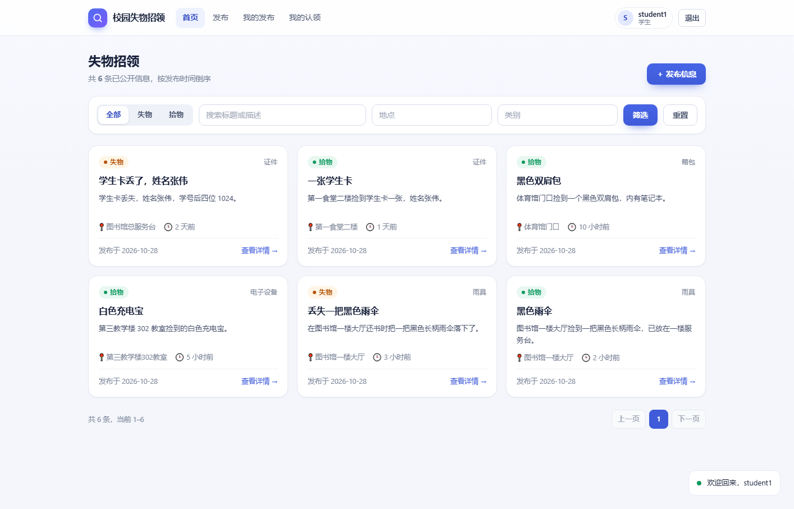
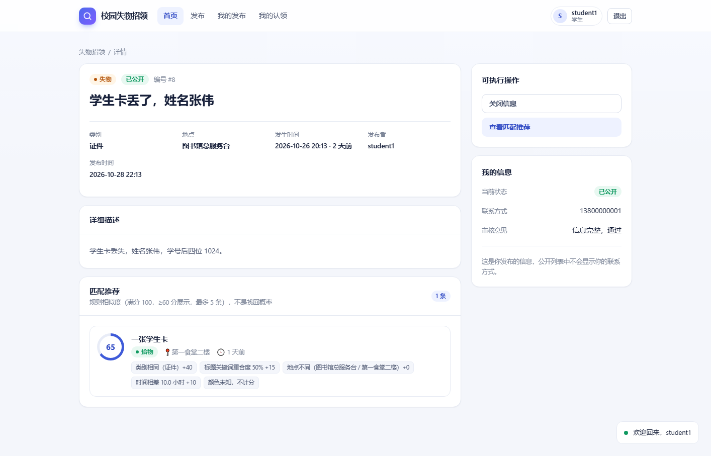
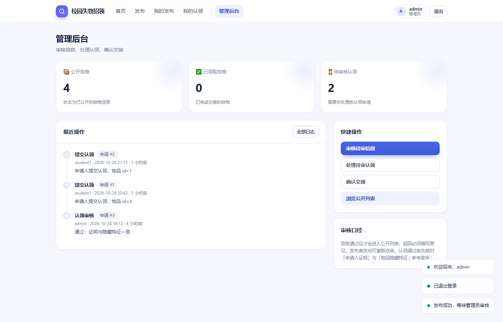
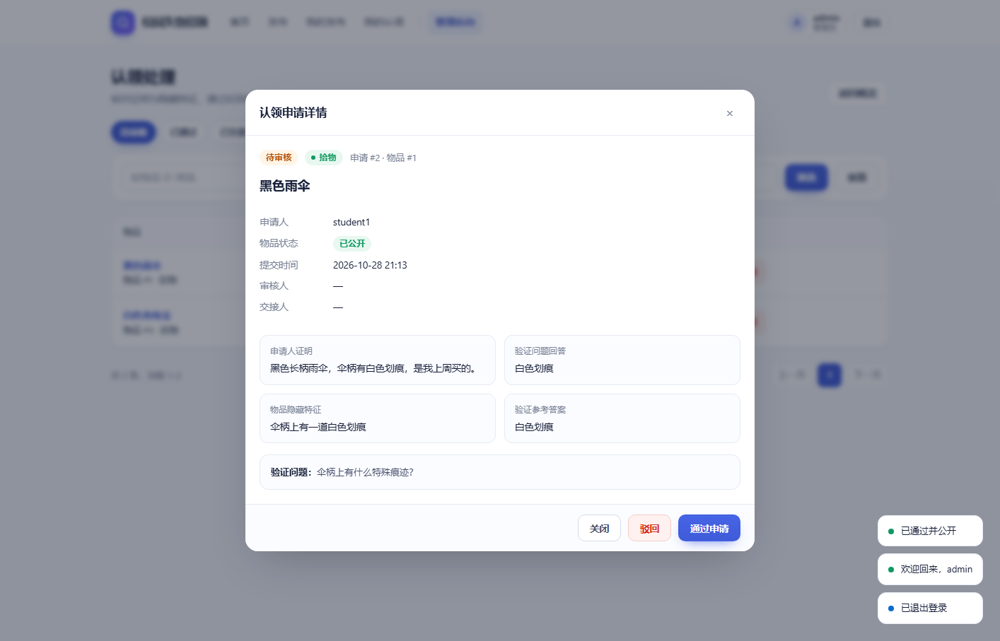
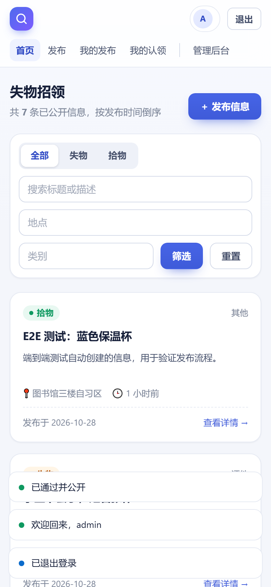

# School-Finding 校园失物招领

学生发失物或拾物，管理员审核，系统按规则算相似度推荐，然后走认领、审核、交接。
技术栈 Spring Boot 3 + MySQL + MyBatis，SQL 手写在 XML 里，接口文档用 Knife4j。

---

## 〇、本地测试环境

这套版本是我本地实际跑通的（路径是我的，你机器上不一定一样，版本对上就行）：

| 项 | 版本 / 配置 |
|---|---|
| 操作系统 | Windows 11 |
| JDK | OpenJDK 21（编译目标是 Java 17，JDK 17 及以上都能跑） |
| Maven | 3.9.x（用 IDEA 内置的也行） |
| MySQL | 8.0.x，端口 3306 |
| 数据库账号 | `root` / `123456`，库名 `school_finding` |
| 框架 | Spring Boot 3.2.5 + mybatis-spring-boot-starter + Knife4j 4.5.0 |
| IDE | IntelliJ IDEA，项目 SDK 选 21，语言级别选 17 |

数据库密码不是 `123456` 的话，两种改法（选一个）：

- 改 `src/main/resources/application.yml` 里的 `spring.datasource.password`；
- 或者不动代码，设环境变量 `DB_PASSWORD`（还有 `DB_HOST` / `DB_PORT` / `DB_NAME` / `DB_USERNAME`），默认值仍然是本机这套。

依赖不用手动装，`mvn` 第一次跑会自动下载，需要联网。

---

## 一、怎么跑起来

**1. 建库和灌数据**

```bash
mysql -uroot -p123456 < sql/init.sql
```

这条命令会自动建 `school_finding` 库、建 4 张表、写入 8 条信息和 3 条申请。脚本可以反复跑，每次都回到同一份干净数据。

Windows 的 PowerShell 不认 `<`，改写成这样：

```powershell
& "C:\Program Files\MySQL\MySQL Server 8.0\bin\mysql.exe" -uroot -p123456 -e "source D:/school-finding/sql/init.sql"
```

**2. 启动**

不想碰命令行的话，直接双击项目根目录的 **`start.bat`**（见第九节，没装 Maven 也能跑）。命令行方式：

```bash
mvn spring-boot:run
```

也可以先打包再运行：

```bash
mvn clean package
java -jar target/school-finding-1.0.0.jar
```

控制台出现 `Tomcat started on port 8080` 就启动成功了。

**3. 打开页面**

| 地址 | 用途 |
|---|---|
| http://localhost:8080/ | 前端页面（学生端 + 管理端，随后端一起发布） |
| http://localhost:8080/doc.html | 中文文档，看接口分组和字段说明 |
| http://localhost:8080/swagger-ui.html | 实际发请求 |

---

## 二、测试账号

| 账号 | 密码 | 角色 |
|---|---|---|
| student1 | 123456 | 学生 |
| student2 | 123456 | 学生 |
| admin | 123456 | 管理员 |

token 的使用方式：先调登录接口，复制返回的 `data.token`，点右上角 Authorize 粘进去，不要加 Bearer 前缀。

换角色要重新登录换一次 token。服务一旦重启，之前发出去的 token 全部失效，得重新登录。

---

## 三、接口清单

一共 23 个接口，分四个分组：

| 分组 | 数量 | 做什么 |
|---|---|---|
| 01-认证 | 3 | 注册、登录、当前用户 |
| 02-失物招领信息 | 8 | 发布、公开列表、详情、匹配推荐、编辑重投、关闭、重新发布、我的发布 |
| 03-认领申请 | 3 | 提交认领、我的申请、取消申请 |
| 04-管理端 | 9 | 物品列表、信息审核、认领列表、认领详情、认领审核、撤销、交接确认、统计、日志 |

---

## 四、关键规则

**状态流**：发布后是 `PENDING`，审核通过变 `PUBLIC`，交接后变 `CLAIMED`；驳回是 `REJECTED`，关闭是 `CLOSED`。公开列表里只有 `PUBLIC` 的信息。

**脱敏**：公开列表和详情里不返回 `contact`、`hiddenFeature`、`verifyAnswer` 这三个字段，只有管理员查得到。详情会返回 `verifyQuestion` 给认领人作答。

**匹配算法**：类别相同得 40 分，标题关键词重合度得 30 分，地点相同得 20 分，时间接近得 10 分，颜色不计分。总分 60 分以上取前 5 条，每条带分数和理由。这个分数是规则相似度，不是找回概率。

**认领**：同一个人对同一物品只能有一个有效申请。同一物品只能有一个申请审核通过。交接后物品变 `CLAIMED`，不能再认领。

**重复交接**：再点一次不会重复写交接记录，直接返回 400。

**并发**：两个管理员同时审批同一物品的两个不同申请，只有一个能成功。实现方式是事务加行锁，锁的是 item 表那一行。

---

## 五、跑测试

```bash
mvn test
```

一共 8 个用例：2 个并发测试，证明一胜一败；6 个匹配样例，证明分数可复现。

---

## 六、没做的部分

- 图片只留了字段，没做上传和校验。
- token 存在内存里，没有 JWT 刷新，也没有过期续期。
- 统计只有 3 个数字，没有图表。
- 没有端到端自动化测试，并发保护也只覆盖认领审批这一处。

---

## 七、容易出错的地方

1. 发布接口里的 `happenTime` 必须是 `2026-10-22 09:30:00` 这种格式。Swagger 会自动填成 `2026-10-22T13:26:38.200Z`，带着 T 和 Z，后端不认，会返回 `code:500`。手动把那个字段改掉就行。

2. `init.sql` 是删表重建，演示过程中不要跑，会把数据清空。只在演示开始前跑一次。

3. `/api/admin/claims` 里的 `itemId` 是物品 id，用来筛选，不是申请 id。要看某条申请详情，用 `GET /api/admin/claims/{id}`。

4. IDEA 里的项目 SDK 不要选太高的版本。Spring Boot 3.2.5 内置的 ASM 读不了太新的 class 文件，编译能过但一运行就报 `ExceptionInInitializerError`。项目 SDK 选 21、语言级别选 17 最稳。嫌麻烦就在 Maven 面板里跑 `test`，它永远按 pom 里的 Java 17 编译。

---

## 八、前端页面

前端是一个**零构建的静态单页应用**，直接放在 `src/main/resources/static/` 里，跟着 Spring Boot 一起发布。所以不需要 Node、不需要单独起服务、也没有跨域问题：`mvn spring-boot:run` 之后打开 <http://localhost:8080/> 就是完整界面。

### 页面

| 路由 | 页面 | 说明 |
|---|---|---|
| `#/login` | 登录 / 注册 | token 存 localStorage，注册出来都是学生 |
| `#/items` | 失物招领列表 | 类型 / 类别 / 地点 / 关键词筛选，分页，只展示 `PUBLIC` |
| `#/items/:id` | 详情 | 元信息、描述、验证问题、匹配推荐（分数环 + 理由标签）、认领入口 |
| `#/publish` | 发布 | 提交后进入待审核 |
| `#/items/:id/edit` | 编辑重投 | 仅待审核 / 已驳回 |
| `#/my/items` | 我的发布 | 状态筛选、编辑、关闭、重新发布 |
| `#/my/claims` | 我的认领 | 申请状态、处理意见、取消待审申请 |
| `#/admin` | 管理后台 | 三个统计数字、快捷入口、最近操作 |
| `#/admin/items` | 信息审核 | 通过 / 驳回（必填意见），弹窗里能看到联系方式与隐藏特征 |
| `#/admin/claims` | 认领处理 | 核对证明与隐藏特征，通过 / 驳回 / 撤销 / 交接 |
| `#/admin/logs` | 操作日志 | 最近 20 / 50 / 100 条 |

### 文件

```
src/main/resources/static/
├── index.html
└── assets/
    ├── css/app.css
    ├── favicon.svg
    └── js/
        ├── app.js            路由、登录守卫、顶栏
        ├── core.js           请求封装、会话、弹窗、toast
        ├── tpl.js            纯渲染函数（转义、徽章、分页、卡片）
        ├── views.student.js  学生端页面
        └── views.admin.js    管理端页面
```

### 约定

- 后端永远返回 `{code, msg, data}`，`code !== 0` 统一按失败处理；`code === 401` 会让前端清 token 并跳登录。
- 所有用户输入进 HTML 前都过 `esc()`，详情描述保留换行。
- 时间：后端是 `yyyy-MM-dd HH:mm:ss`，`datetime-local` 提交前补齐 `:00`；展示用相对时间。
- 无第三方依赖，只要浏览器支持 ES Modules（Chrome / Edge / Firefox / Safari 现代版本都行）。

### 界面预览












---

## 九、一键启动（start.bat）

不想开 IDEA、也不想装 Maven 时，直接双击项目根目录的 **`start.bat`**。它按顺序做这几件事：

1. 8080 已经在监听 → 直接打开浏览器，不会重复启动；
2. 找到 `mvn` → 走 `mvn spring-boot:run`；
3. 没有 `mvn` → 调用 `scripts/run-local.ps1`：从本地 `~/.m2/repository` 拼 classpath，用 JDK 自带的 `javac` 编译到 `target/classes`，再启动。首次会编译 40 多个源文件，大约十几秒；之后检测到 class 比源码新就直接跳过编译。

启动成功后会自动打开 <http://localhost:8080/>，Spring 日志在一个单独的窗口里——**关掉那个窗口就等于停止服务**；也可以双击 **`stop.bat`**，它按端口找到进程再停掉。

脚本会自动检查并提示这三件事：

| 前提 | 不满足时 |
|---|---|
| JDK 17+（`JAVA_HOME` 指向它，或 `java`/`javac` 在 PATH 里） | 提示装 JDK，或用 IDEA |
| MySQL 已启动（`net start MySQL`） | 提示 3306 没监听 |
| 本地 `.m2` 里已有依赖（用 Maven 构建过，或用 IDEA 跑过一次） | 提示先用 Maven 构建一次 |

三个文件的分工：

```
start.bat                双击入口：端口检查 → Maven 或本地模式
stop.bat                 按 8080 端口找进程并停止
scripts/run-local.ps1    本地模式：javac 编译 + java 启动（可单独运行，支持 -Port / -NoBrowser）
```

> `run-local.ps1` 里的依赖筛选是为了避开 `.m2` 中同时存在的 Spring Boot 3.5.6 / Jackson 2.19 等新版本，保证跑起来的是 pom 里那套 3.2.5。等你之后装了 Maven，`start.bat` 会自动优先走 Maven，这个脚本就不再需要了。

---

## 十、连接数据库

### 连接参数

| 项 | 值 |
|---|---|
| 主机 | `127.0.0.1` |
| 端口 | `3306` |
| 用户 | `root` |
| 密码 | `123456` |
| 库名 | `school_finding` |
| 字符集 | `utf8mb4` |

这个密码是 `src/main/resources/application.yml` 里的**默认值**，也是 `db.bat` 里写死的。改密码时：

- 后端：改 `application.yml`，或者设环境变量 `DB_PASSWORD`（推荐，不用改代码）；
- `db.bat`：改第 28 行那串 `-p123456`。

### 方式一：双击 `db.bat`（最快）

双击项目根目录的 **`db.bat`**，直接进入 `school_finding` 库的交互式命令行。它自带 `--default-character-set=utf8mb4`，中文不会乱码。

也可以带参数当一次性查询用：

```bat
db.bat -e "SHOW TABLES;"
db.bat -e "SELECT id, type, title, status FROM item;"
```

脚本会先找 PATH 里的 `mysql`，找不到再试本机常见安装目录（这台机器是 `D:\mysql\mysql-8.0.41-winx64\bin`）。

### 方式二：命令行手敲

```powershell
& "D:\mysql\mysql-8.0.41-winx64\bin\mysql.exe" -uroot -p123456 --default-character-set=utf8mb4 school_finding
```

### 方式三：图形化工具

DBeaver、Navicat、MySQL Workbench、IDEA 的 Database 面板都可以，新建 MySQL 连接时填上面的参数即可。注意两点：

- 主机填 `127.0.0.1` 而不是 `localhost`，某些客户端会优先走 IPv6 或命名管道，容易连不上；
- 字符集选 `utf8mb4`，否则中文表和注释会显示成问号。

### 常用 SQL

```sql
SHOW TABLES;                                     -- sys_user / item / claim / op_log
DESC item;                                       -- 看字段
SELECT id, type, title, status, publisher_id FROM item ORDER BY id;
SELECT id, item_id, applicant_id, status FROM claim ORDER BY id;
SELECT id, operator_name, action, target_id, opinion, created_at FROM op_log ORDER BY id DESC LIMIT 20;
```

### 重置数据 / 备份

```powershell
# 重置回种子数据（会删表重建，演示前跑一次就好）
& "D:\mysql\mysql-8.0.41-winx64\bin\mysql.exe" -uroot -p123456 -e "source C:/path/to/sql/init.sql"

# 备份
& "D:\mysql\mysql-8.0.41-winx64\bin\mysqldump.exe" -uroot -p123456 --default-character-set=utf8mb4 school_finding > backup.sql
```

四张表的分工：`sys_user` 用户、`item` 失物/拾物信息、`claim` 认领申请、`op_log` 操作日志。

---

## 十一、把项目交给别人

### 对方需要装什么

| 必须 | 说明 |
|---|---|
| JDK 17+ | `java -version` 能跑就行 |
| MySQL 8.x | 端口 3306，密码可以和他本机一致，不一致就改配置 |
| Maven 3.9+ | 首次构建要联网下依赖；用 IDEA 内置的也行 |
| 浏览器 | 现代浏览器即可，**前端不用装 Node** |

`start.bat` 的"本地模式"（`run-local.ps1`）读的是**本机 `.m2` 里已经下好的 jar**，对方新机器上大概率是空的，所以第一次请让他用 `mvn spring-boot:run`，跑通之后 `.m2` 有了依赖，`start.bat` 才会有意义。

### 对方要做的三步

```powershell
# 1. 建库 + 灌种子数据
mysql -uroot -p你的密码 < sql/init.sql

# 2. 告诉他数据库密码（不用改代码）
$env:DB_PASSWORD = "他的密码"        # cmd 用: set DB_PASSWORD=他的密码

# 3. 启动
mvn spring-boot:run
```

浏览器打开 <http://localhost:8080/>，用 `student1 / 123456` 或 `admin / 123456` 登录。

### 传什么、别传什么

- **只传 `School-Finding/` 这一层**：74 个文件，约 1 MB，含源码、前端、SQL、文档和截图；
- **别把外层目录整个打包**：外层那个 `hello.txt` 是个模板注入的测试样本，跟项目无关，传出去容易吓到人；
- `target/`、`.idea/` 不用传，`.gitignore` 已经排除；
- 用 Git 传最省事，对方 `git clone` 之后直接 `mvn spring-boot:run`。

### 对方跑不起来时对照

| 现象 | 原因 |
|---|---|
| `Unknown database 'school_finding'` | 没执行 `sql/init.sql` |
| `Access denied for user 'root'` | 密码不对：改 `application.yml` 或设 `DB_PASSWORD` |
| `Communications link failure` | MySQL 没启动（`net start MySQL`） |
| `Port 8080 was already in use` | 端口被占，加参数 `--server.port=8081` |
| 打开页面是 404 | 地址要访问 `http://localhost:8080/`，不是 `/index.html` 拼错路径 |
| 页面白屏 | 用 `file://` 直接打开了 `index.html`，必须走服务 |
| `java: 错误: 不支持发行版 17` | JDK 太旧，装 17 以上 |
